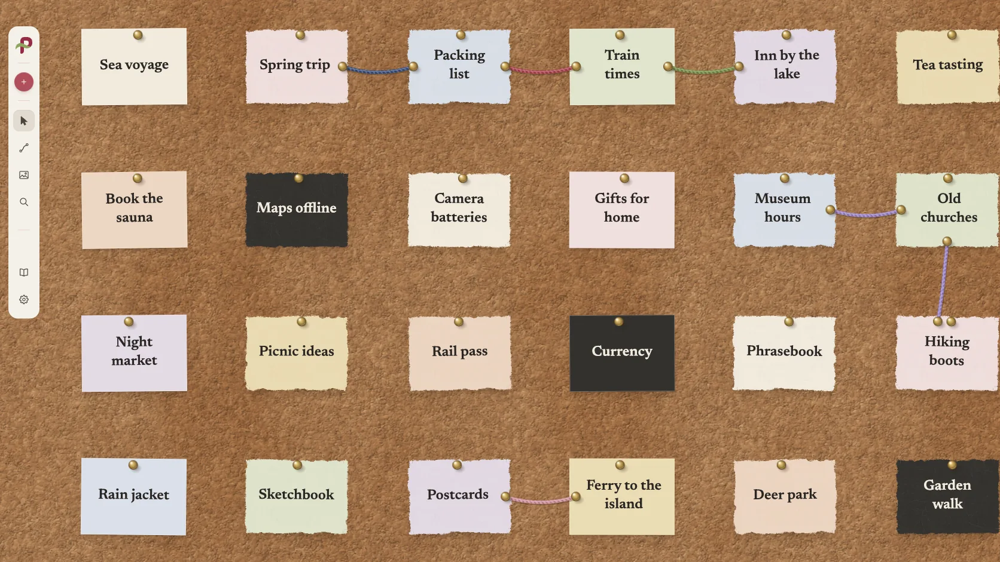
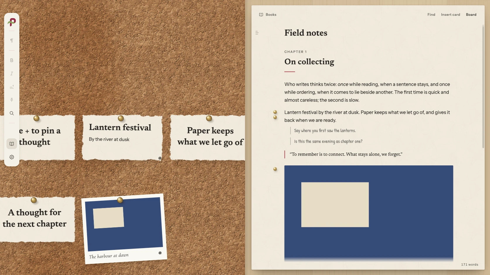
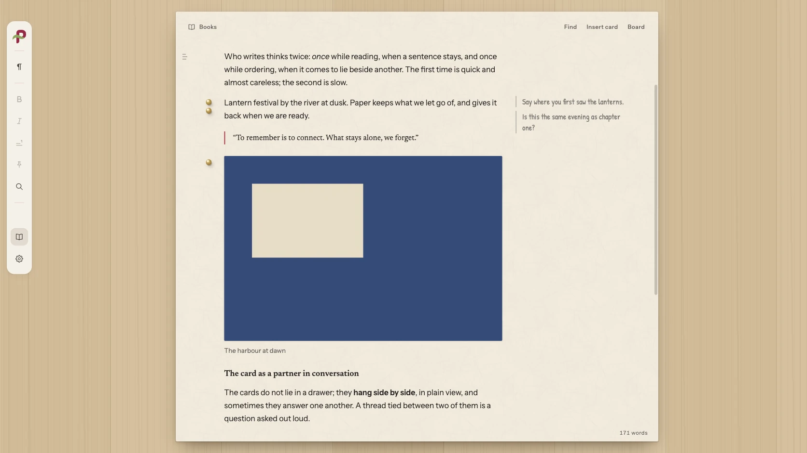
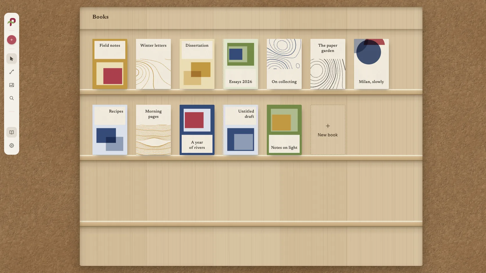

<p align="center">
  
</p>

<h1 align="center">Papertie</h1>

<p align="center">
  One board for a lifetime of notes, and a writer for every book they become.
</p>

<p align="center">
  <a href="https://github.com/dm807cam/papertie/releases/latest"></a>
  <a href="LICENSE"></a>
  <a href="https://github.com/dm807cam/papertie/actions/workflows/ci.yml"></a>
</p>



## What Papertie is

Papertie is a desktop app for macOS, Windows and Linux. It gives you one cork board for
everything you read and think, and a writer for the books that grow out of it.

You pin a paper note for each idea, quotation, source or question, and tie the notes that belong
together with yarn. The board is not for one project. It is meant to be kept for life: every
subject you care about, every book and paper you have read, in one place, with the connections
between them visible. Beside the board is a wooden shelf of books, and a writer in which the
notes become chapters, each paragraph still knowing which note it came from. The same board can
feed every book, thesis or essay you would like to write.

Everything stays on your computer. There is no account, no sign-in and no sync, and your notes
are kept as plain text you can read without Papertie.

## Where the idea comes from

The idea goes back to the author's time at Cambridge, and to a friend there, a scholar who is
now an emeritus professor. For every book and every paper he read, he wrote a note and put it in
a box. Over a working life the boxes became his memory: whatever he came to write, the reading
was already there, in his own words, waiting to be laid out and put in order.

Papertie is that box of notes with two things added. The notes hang on a board where you can
see them all and tie one to another, so a thought from one field can sit next to a thought from
another. And the board opens straight onto the page, so the step from a table covered in notes
to a first draft is a drag of the mouse.

It is a not-for-profit project, free to use and open source.

## Features

### The board

- One board for everything, built to last a lifetime: it holds up to 500,000 notes. Typing and
  moving notes were measured to stay as quick at 500,000 as at 1,000, and zooming out to see
  the whole board stays smooth. A board that large takes longer to open: its first view comes
  in a second or two, and the rest of the board arrives in the background.
- Paper notes in several colours and styles, photos as prints, and small tags. A note can carry
  a free-text reference at its bottom (a source, a page, a link).
- Yarn ties notes into threads. A thread runs from pin to pin through as many notes as you
  like, and follows them when they move.
- Focus mode shows one note and what it is tied to, and widens step by step along the yarn.
- Search finds any note by its text (⌘K, or Ctrl+K).
- The whole board works from the keyboard. Accessibility is tested automatically (axe), and
  there is a [manual screen-reader checklist](docs/a11y/voiceover-walkthrough.md).

### From notes to a book



- The board and an open book sit side by side; drag the seam between them, or hide the board
  with one key (⌘\\, or Ctrl+\\).
- Drag a note into the book and it lands as a paragraph, a quotation or a prompt to yourself.
  A photo becomes a figure with its caption. Hold Alt (⌥) to move the note instead of copying it.
- A note that has a reference drops in as a quotation with the reference as its footnote.
- Each paragraph that came from a note keeps a small pin in the margin. It shows the note and
  finds it on the board, and the note on the board lists the books that use it.
- Drag selected text out of the book and it becomes a note that remembers its book.
- Every drag has a keyboard way: ⌘K in the book inserts a note, and Pin to board makes one.

### The writer



- Chapters, sections, quotations, lists, bold and italic. The tools are in the sidebar, and the
  usual typed shortcuts work (`# ` for a chapter, `## ` for a section).
- Footnotes, written from the sidebar or by typing `^[`. On a wide page they sit in the margin
  beside the line their number is on; on a narrow one, under the paragraph.
- Prompts: notes to yourself beside the text, which are never exported.
- An outline of the chapters, find across the whole book, and a word count.
- Books stand on a shelf, each with a cover drawn for it. A deleted book can be put back for
  30 days.
- A book exports to Markdown (with its images) and to Word (`.docx`, with real footnotes).



### Your data

- Every change is saved as you make it. Undo and redo cover the board and the books in one
  history.
- Papertie keeps a backup of the board in every hour you change it: all of them for two days,
  then one a day for a month, then one a week for about six months. **Settings → History** lists
  them and restores one, and a restore can itself be undone there.
- **Settings → Export** saves everything (the board, its photos and its books) as one
  `.papertie` file, which Papertie can import again on this computer or another.
- The board is a plain text file, `board.jsonl`, one record per line. Its format is written
  down in [docs/schema](docs/schema/board-v1.md).

More screenshots of every screen are in [docs/screenshots](docs/screenshots).

## Download and install

Get the latest release from
**<https://github.com/dm807cam/papertie/releases/latest>**:

| System                       | File                                                                   |
| ---------------------------- | ---------------------------------------------------------------------- |
| macOS, Apple silicon         | `Papertie-<version>-mac-arm64.zip`                                     |
| macOS, Intel                 | `Papertie-<version>-mac-x64.zip`                                       |
| Windows 10 and 11, x64       | `Papertie-<version>-win-x64.exe`                                       |
| Linux, any desktop           | `Papertie-<version>-linux-x86_64.AppImage` or `…-linux-arm64.AppImage` |
| Debian, Ubuntu and their kin | `Papertie-<version>-linux-amd64.deb` or `…-linux-arm64.deb`            |

**The packages are not code-signed yet.** Signing certificates cost money the project does not
have, so each system warns you once before it opens Papertie. After that it opens like any other
app.

- **macOS:** unzip the file and move **Papertie** to Applications. Right-click it and choose
  **Open**, then **Open** again. On recent versions of macOS that offer no Open there, try to
  open it once, then go to **System Settings → Privacy & Security** and choose **Open Anyway**.
  Or, in Terminal: `xattr -dr com.apple.quarantine /Applications/Papertie.app`.
- **Windows:** run the installer. At **Windows protected your PC** (SmartScreen), choose
  **More info**, then **Run anyway**. Papertie installs for you alone, without administrator
  rights.
- **Linux:** make the AppImage executable and run it
  (`chmod +x Papertie-*.AppImage && ./Papertie-*.AppImage`), or install the `.deb` with
  `sudo apt install ./Papertie-*.deb`. Some distributions need FUSE 2 for AppImages
  (`libfuse2`, or `libfuse2t64` on Ubuntu 24.04).

To check a download, fetch `SHA256SUMS` from the same release into the same folder and run:

```sh
sha256sum --ignore-missing -c SHA256SUMS     # macOS: shasum -a 256 --ignore-missing -c SHA256SUMS
```

[docs/release.md](docs/release.md) has more about each package.

## Updates

Once a day, Papertie asks GitHub whether a newer release exists, and tells you on a small slip
if there is one. Nothing is downloaded or installed automatically: **Download** on the slip
opens the release page in your browser, and you install the new version as you did the first.

To turn the daily check off, untick **Settings → Preferences → Check for updates
automatically**. **Check for Updates…** in the menu asks whenever you like, either way.

## Where your data lives

| System  | Folder                                                  |
| ------- | ------------------------------------------------------- |
| macOS   | `~/Library/Application Support/Papertie/`               |
| Windows | `%APPDATA%\Papertie\`                                   |
| Linux   | `~/.config/Papertie/` (or `$XDG_CONFIG_HOME/Papertie/`) |

The board (`board.jsonl`), its photos, its books and its hourly backups are in that folder's
`data/`. The rest of the folder is the window's size and place, caches and the log. Uninstalling
Papertie leaves the folder where it is.

The hourly backups are on the same disk as the board. For a copy somewhere else, use
**Settings → Export → Download .papertie**, or quit Papertie and copy the folder (Time Machine,
File History and most backup tools already include it).

## Privacy

Papertie has no account and no telemetry, and it opens no network port. It makes exactly one
kind of network request: the update check, a `GET` to
`https://api.github.com/repos/dm807cam/papertie/releases/latest`. That request carries the
Papertie version (as its `User-Agent`) and, as any request does, your IP address reaches GitHub.
It carries no cookies and nothing about you, your board or your books. With the check turned
off, Papertie makes no network requests at all.

Web links in your notes open in your system browser, never inside Papertie.

## Project status

Papertie is early software, at version 0.x. It is careful with your data (every write is
journalled, and the tests kill the store mid-write to check that nothing is lost), but expect
rough edges.

One thing to know before you rely on it: **the file format may change between versions, and
Papertie does not convert files.** A board or a `.papertie` export written by another version of
the format is refused with a message, and left untouched, rather than converted. Until 1.0, keep
the version of Papertie that wrote a file if you need to open that file again, and export a book
to Markdown or Word when you want a copy that will always open.

## Building from source

You need Node 22.12 or newer and pnpm 9 (`corepack enable pnpm`).

```sh
pnpm install
pnpm dev:desktop     # builds the web app, then opens Papertie in Electron on your own data
pnpm check           # lint, typecheck and the unit tests
pnpm test:crash      # the store's crash tests (they kill a child process mid-write)
pnpm e2e:desktop     # end-to-end tests of the desktop shell (builds the app first)
pnpm e2e:app         # the journeys through the board and the books, in the desktop app
```

To make a package for your own system, build and then pack (the result is in
`apps/desktop/release/`):

```sh
pnpm --filter @papertie/web build
pnpm --filter @papertie/desktop build
pnpm --filter @papertie/desktop dist --mac --arm64     # or --win --x64, --linux --x64
```

Set `PAPERTIE_USER_DATA` to an empty folder to run Papertie on data of its own instead of your
board.

## Repository layout

| Path            | What it is                                                                                                                                                                                                                                                            |
| --------------- | --------------------------------------------------------------------------------------------------------------------------------------------------------------------------------------------------------------------------------------------------------------------- |
| `apps/web`      | The interface: the board, the shelf and the writer (React, canvas for yarn and pins)                                                                                                                                                                                  |
| `apps/server`   | The store: reads, writes and backs up the board. It runs inside the app's main process and is called in-process; it is not a network server                                                                                                                           |
| `apps/desktop`  | The Electron shell: window, menu, file association, update check, packaging                                                                                                                                                                                           |
| `packages/core` | What the interface and the store share: the record schemas, the ops and their rules, the file format                                                                                                                                                                  |
| `tools`         | Generators and build helpers: textures, test boards and books, the bundle budget                                                                                                                                                                                      |
| `e2e`           | Playwright tests: the desktop app, the journeys, and the canvas on development pages                                                                                                                                                                                  |
| `docs`          | [Architecture decisions](docs/adr), the [file format](docs/schema/board-v1.md), the [threat model](docs/security/threat-model.md), the [visual language](docs/design/visual-language.md), the [acceptance criteria](docs/acceptance.md), [releasing](docs/release.md) |
| `web`           | The source of the product page                                                                                                                                                                                                                                        |

## Contributing

Issues are welcome: bugs, rough edges, and ideas. For a bug, say which version and system you
use and how to reproduce it. A board file helps, but it contains your notes, so share one only
if you are happy for others to read it.

Pull requests are welcome too. Before you open one, run `pnpm check`, and for a change in
behaviour the end-to-end tests that cover it (`pnpm e2e:desktop`, `pnpm e2e:app`). Code style is
whatever [Biome](https://biomejs.dev) says (`pnpm lint`; `pnpm exec biome check --write .` fixes
what it can). New behaviour comes with a test. For anything larger than a fix, open an issue
first so the direction can be agreed before you write it.

Some things are decided and will stay: Papertie is local only (no accounts, no sync), has one
board rather than several, and is a desktop app.

## Security

Please report vulnerabilities privately through
[GitHub's security advisories](https://github.com/dm807cam/papertie/security/advisories/new),
not in a public issue. [SECURITY.md](SECURITY.md) has the details, and
[docs/security/threat-model.md](docs/security/threat-model.md) says what Papertie defends
against.

## Licence

Papertie is free software under the **GNU General Public License, version 3 or (at your option)
any later version** ([LICENSE](LICENSE)). In plain words: you may use it, study it, change it
and pass it on, for any purpose. If you distribute it, changed or not, you must do so under the
same licence and make the source available. It comes with no warranty.

## Third-party software and fonts

Papertie bundles these typefaces, each under the
[SIL Open Font License 1.1](https://openfontlicense.org):

- [Newsreader](https://github.com/productiontype/Newsreader) (titles),
- [Instrument Sans](https://github.com/Instrument/instrument-sans) (text and interface),
- [Cormorant Garamond](https://github.com/CatharsisFonts/Cormorant),
- [Patrick Hand](https://fonts.google.com/specimen/Patrick+Hand) (the pencilled notes),

taken from the [Fontsource](https://fontsource.org) packages named in `apps/web/package.json`.

Every other dependency is listed, with its exact version, in `pnpm-lock.yaml`, and is used
under its own licence.

## Acknowledgements

Papertie stands on [Electron](https://www.electronjs.org), [React](https://react.dev),
[Hono](https://hono.dev), [sharp](https://sharp.pixelplumbing.com) and
[Playwright](https://playwright.dev), and on the type designers whose fonts give it its voice.
